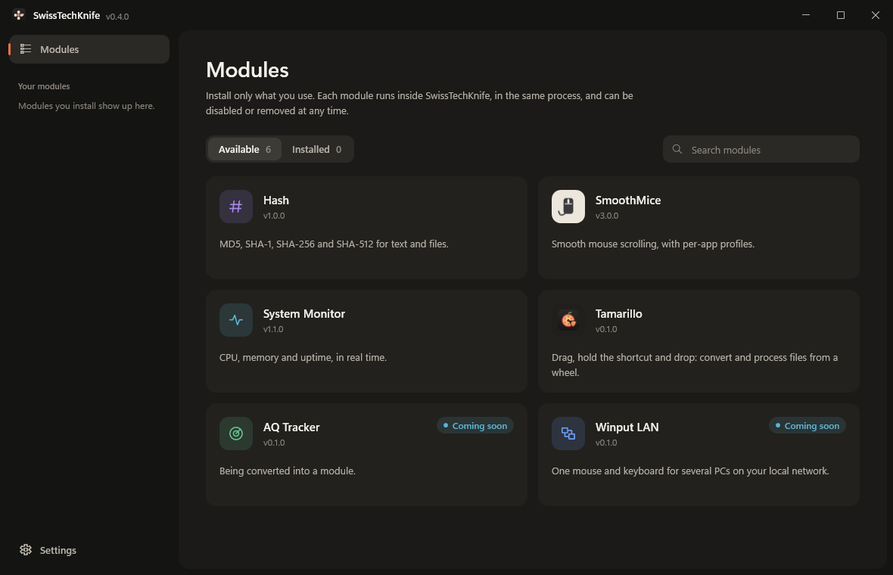

  

<h1 align="center">SwissTechKnife</h1>

  <strong>All your Windows utilities in one place.</strong> 
  Install only what you use, and turn each tool on or off whenever you want.

  
  
  
  

  <a href="https://github.com/luingry/SwissTechKnife/releases/latest"><b>⬇ Download for Windows</b></a>
  &nbsp;·&nbsp;
  <a href="#modules">Modules</a>
  &nbsp;·&nbsp;
  <a href="#getting-started">Getting started</a>
  &nbsp;·&nbsp;
  <a href="#for-developers">For developers</a>

  

## What it is

SwissTechKnife is a lightweight app that brings many tools together as **modules**. Instead of installing and maintaining a separate program for every little thing, you pick the modules you want from a list and they run inside SwissTechKnife, with the same look and the same settings.

- **Lightweight.** A small Windows app that starts fast; modules only load when you enable them.
- **Modular.** Install, enable, disable and remove tools one by one, without touching the rest.
- **Always up to date.** SwissTechKnife and its modules update from inside the app, and you decide when.
- **Private by design.** Everything runs on your computer.

## Modules

| Module | What it does |
|---|---|
| **SmoothMice** | Smooth mouse scrolling across Windows, with per-app tuning and no interference with games. |
| **Tamarillo** | Hold Ctrl + Alt + Shift while dragging files and pick what to do from a wheel: convert, resize, compress, recognize text and more. |
| **System Monitor** | Shows processor and memory usage and how long your PC has been on. |
| **Hash** | Computes MD5, SHA-1, SHA-256 and SHA-512 for text and files. |
| **Winput LAN** | *Coming soon:* one mouse and keyboard for several PCs on your network. |
| **AQ Tracker** | *Coming soon.* |

New modules show up in the list automatically as soon as they're published.

## Getting started

1. Download and run the installer, `SwissTechKnife-<version>-setup.exe`.
2. Open SwissTechKnife and go to **Modules**.
3. Click the module you want, then **Install**.
4. It appears in the sidebar under **Your modules**. Click it to open.

Use the switch on a module's card to **enable or disable** it without uninstalling. If a module has options, they're in the **Settings** tab of its window, and the **Release notes** tab shows what changed in each version.

## Settings

Click the gear at the bottom of the sidebar:

- **Language:** English (default) or Português (Brasil). The change applies instantly.
- **Check for updates:** daily, weekly, monthly or never. You can also check right away.
- **Start with Windows:** SwissTechKnife opens on its own when you sign in.
- **Hide to the notification area on close:** closing the window keeps your modules running. To quit for good, right-click the icon near the clock and choose **Exit**.

## Updates

SwissTechKnife and its modules update from inside the app. When a new version is available you see what changed and choose when to update; everything else is automatic.

## Privacy and security

- Everything runs on your computer. The app only goes online to check for new modules and updates, and to download them.
- Every module and update is verified before it's installed: if the downloaded file isn't exactly the one that was published, it's rejected and nothing changes.
- Uninstalling a module removes its files right away. Its preferences are kept, in case you install it again.

## Requirements

Windows 10 or 11, 64-bit.

## For developers

- [Development, builds and releases](docs/DEVELOPMENT.md)
- [Building a module](docs/MODULES.md)
- [Design system](docs/DESIGN_SYSTEM.md)
